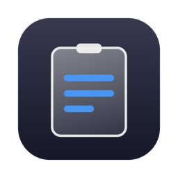
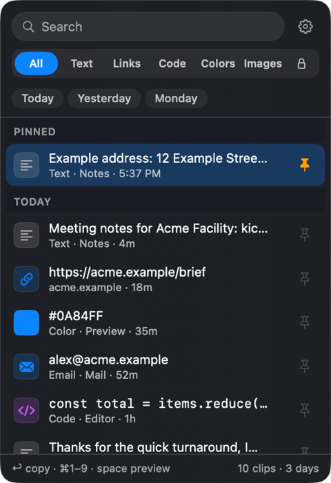
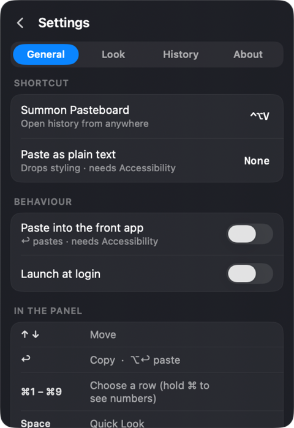

<h1 align="center">Pasteboard</h1>

A clipboard-history manager that lives in your Mac's menu bar.

A clipboard-history manager that lives in your Mac's menu bar. Everything you copy is
kept in a searchable history, grouped by day, that survives restarts, with a
Liquid Glass look on macOS 26.

Screenshots use made-up example clips (Acme Facility, acme.example); no real clipboard history.

- **Search and filter** by kind: links, colors, emails, code, images, text; every word you type must match
- **Keyboard first**: ↑↓ to move, ↩ to copy (⌥↩ to paste), ⌘1–9 for the first nine, Space for Quick Look,
  ⇥ to change filter, ⌘P pin, ⌘⌫ delete, Esc to clear or close
- **Pin** clips to keep them forever (the rest are capped at 500, or 100/250/1000 in Settings)
- **Secrets**: a Touch ID–protected password vault in the Keychain; copies clear after 30 s
- **Look**: choose the menu-bar icon (or hide it), accent colour, panel height and position
- **Skips passwords**: anything a password manager marks as concealed is never recorded
- **Paste stack**: queue several clips and paste them one after another with ⌘V
- **Text transforms**: change case, encode/decode, pretty-print or minify JSON, from the right-click menu
- **Paste as plain text** with an optional hotkey
- **Quick Look** preview on hover or Space for code and long clips

## Install

1. Download **Pasteboard-x.y.z.dmg** from the [latest release](https://github.com/SamDeHerdt/Pasteboard/releases/latest).
2. Open it and drag **Pasteboard** onto **Applications**.
3. The first time you open it, macOS may warn that it's from an unidentified developer.
   It isn't signed with a paid Apple Developer account. Fix this once by either:
   - right-clicking Pasteboard in Applications → **Open** → **Open**, or
   - running `xattr -dr com.apple.quarantine /Applications/Pasteboard.app` in Terminal.

Pasteboard appears as a clipboard icon in the menu bar. Press **⌃⌥V** (changeable in
Settings) to open your history. To have a clip paste straight into the front app, allow
Pasteboard under **System Settings → Privacy & Security → Accessibility**.

Requires macOS 14 or later. Runs on both Apple silicon and Intel Macs.

## Updates

Pasteboard checks for new versions once a day and offers to install them. To check right
away, right-click the menu-bar icon → **Check for Updates…**. Updates are signed and verified
before they're installed.

## Privacy

Your history stays on your Mac, in `~/Library/Application Support/Pasteboard/history.json`.
Secrets are stored in your login Keychain, not in the history file. Pasteboard asks for
Touch ID (or your Mac password) before every copy. Because the app is not signed with a
paid Apple Developer ID, that check is enforced by Pasteboard rather than by the Secure
Enclave, and macOS may ask for your login password once after an update so the new
version can read the Keychain again.

Copies that password managers mark as concealed or transient (1Password, Bitwarden,
KeePassXC…) are skipped unless you turn that off in Settings › History.
The only network request Pasteboard makes is the daily update check to this repository.
*Report a Problem…* in Settings › About opens a GitHub issue pre-filled with the app
version, macOS version and chip — never your clips.

## Issues

Found a bug? Use **Settings › About › Report a Problem…** in the app, or
[open an issue](https://github.com/SamDeHerdt/Pasteboard/issues). This repository holds
the downloads and the update feed; the source code is not public.
